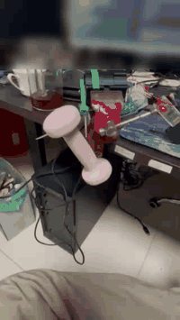

# L103 + DRV8313 + AS5600 关节电机驱动板（软硬件 + 两级行星减速机）

[中文](README.md) | [English](README.en.md)

**CH32L103 主控 + DRV8313 三相驱动 + AS5600 磁编码器**的关节电机驱动板，跑 FOC 的固件、
调参用的上位机，以及配套的**两级行星减速机（J 版，25:1）**。



> 实拍演示：本板上电、CAN 连上位机、使能、走位、连续转速。视频里的屏幕与背景已由 AI 打码处理。

MIT License。

---

## 目录

| 目录 | 内容 |
|---|---|
| `hardware/` | KiCad 工程（原理图 + PCB，KiCad 10），`gerber/` 是出板文件，`docs/` 是 IO 分配与网表核对 |
| `firmware/` | CH32L103 固件（FOC + CAN + UART 命令台），Makefile 与 MounRiver Studio 工程两套都在 |
| `tools/` | 命令行小工具：CAN/UART 发命令、走位序列、扫速、编译与烧写脚本 |
| `gearbox-J/` | 两级行星减速机 J 版（25:1）：STEP / STL、渲染、尺寸图、装配说明 |
| `docs/` | 固件与软件设计说明书（同板 USB→CAN 桥那一半） |
| `media/` | 演示动图与视频 |

上位机是独立仓库：[`l103-servo-gui`](https://github.com/bjthemost-hub/l103-servo-gui)（同一套 GUI 也支持 DRV8316C 板）。

---

## 一、硬件

**设计值**（出处：`firmware/User/board.h` 顶部的网表核对注释，2026-09-18 核过一遍）：

| 项 | 值 |
|---|---|
| 主控 | `CH32L103K8U6`（QFN-32） |
| 三相驱动 | `DRV8313`（三半桥，单相使能 EN1/2/3） |
| PWM | `TIM3` 中心对齐，**20 kHz**（`board.h` `DRV_PWM_FREQ_HZ`）→ PA6/PA7/PB0 |
| 使能 | PB3 / PB4 / PB5 → EN1 / EN2 / EN3 |
| 故障 | `nFAULT` → PC14（R5 10 kΩ 上拉到 MCU 侧 +3V3） |
| 电流检测 | `INA240A2` × 2，50 V/V × 10 mΩ = **0.5 V/A**，量程约 ±3.3 A → PA1 / PA4 |
| 编码器 | `AS5600`，I2C1：**PB6 = SCL / PB7 = SDA**，12 位（4096 CPR） |
| CAN | `SN65HVD230`，PB8 = RX / PB9 = TX，**1 Mbps** |
| 调试串口 | UART1：PA9 = TX / PA10 = RX |
| 母线 | 8–60 V（DRV8313 手册），本固件卡 **8–36 V**（`board.h`），默认按 24 V 设计 |

> `nFAULT` 上拉的是 **MCU 侧**的 3V3，跟 DRV8313 有没有在板、有没有供电无关 ——
> 读到高电平只能说明它没把线拉低，不能证明驱动芯片健康。

`hardware/gerber/` 里是可直接下单的 Gerber。原理图导出件见 `hardware/L103_CANUSB_DRV8313.pdf`
和 `hardware/docs/` 里的 PNG/SVG。

## 二、固件

- 控制：PWM 20 kHz；**开环**由 3 kHz 中断推进电角度（`foc_motor.c` `DRIVE_ISR_FREQ_HZ`），
  **闭环**在主循环里跑（要读编码器，不适合塞进中断）。
- 反馈：AS5600 走 I2C1，12 位原始角，固件里做多圈累加与速度估计。
- 参数：极对数 / 堵转阈值 / 母线电压等存在 Flash 配置页，上电读回；读不到就用编译默认值。
  默认电机 `HT4310`、**14 极对**（`board.h` `MOTOR_POLE_PAIRS`）。
- 通信：CAN 1 Mbps（节点 1–63）或串口 115200，两套命令等价。完整命令表见
  `firmware/命令表与使用说明_UART与CAN_2026-09-28.md`。

### 编译

```bash
make -B TOOLCHAIN_PATH="<MounRiver>/resources/app/resources/win32/components/WCH/Toolchain/RISC-V Embedded GCC"
```

### 烧写

```bash
make flash OPENOCD='"<MounRiver>/resources/app/resources/win32/components/WCH/OpenOCD/OpenOCD/bin/openocd.exe"' \
           OPENOCD_SCRIPTS='<MounRiver>/resources/app/resources/win32/components/WCH/OpenOCD/OpenOCD/bin'
```

> **烧写会整片擦掉 Flash，包括参数页** —— 烧完要重新写一次极对数/母线电压再对齐。

也可以直接用 MounRiver Studio 2 打开 `firmware/L103_DRV8313_FOC.wvproj`，F7 编译、一键下载。

> **绝对不要开 `-flto`。** 开了之后启动文件里的 `.weak` 默认中断桩会顶掉真 ISR，
> 编得过、烧上去板子一动不动（现象是 CAN 没反应、串口也没输出）。Makefile 里已写死。

## 三、上位机与工具

- 上位机（独立仓库）：连接、设备表、对齐/使能/失能、走位、速度运动、开环测试、参数读写与存 Flash、序列、波形。
- `tools/l103_can.py`：CAN 发命令（支持达妙 DM-USB2CAN 的 30 字节信封与 CH9433 EVB 裸帧两种转接卡）。
- `tools/l103_seq.ps1`：动作序列；`tools/l103_velsweep.py`：扫速并记录跟随情况。
- `tools/focbuild.ps1` / `focflash.ps1`：编译与烧写。

## 四、减速机（J 版，25:1）

两级行星，每级 3 个行星轮，两级行星轮是**同一个零件**（共 6 个），避免「一级轮装到二级」的错装。
齿数 12 / 18 / 48，模数 0.95，整机 Ø54.811 × 27.10 mm，塑料件 10 件。
零件清单、打印参数、装配顺序、强度与转速边界见 `gearbox-J/README.md`。

> 那些是**设计值/计算值**（建模 + 解析式 + 布尔校核），没有实机打印件的实测背隙。

## 五、安全与边界

- 这是**开发板级**方案，没有做 UL/CE 之类的认证；上电前请自行确认母线与散热。
- **螺丝、外壳绝对不能碰 GND** —— 我们因此烧掉过两颗 DRV8313 和一颗 Si2319。
- 让机构动起来的第一件事永远是**开环**（不读反馈），确认转向、相电流、有没有某相不发力，再进闭环。
- 一旦发现不转、抖动、转速不跟随，**立刻停机**，不要靠抬电压硬顶。
- `A`（对齐）会强行拽转子 —— 对齐前轴必须能自由转。

## 六、关于 AI 辅助

本项目的硬件设计、固件、上位机界面、减速机模型与文档，在设计、编码、调试和写作过程中**大量使用了 AI 辅助**
（OpenAI Codex / GPT 系列模型），README 封面截图里的上位机界面也是由 AI 操作并截取的。
AI 生成的代码与文本均经人工审阅，并在真实板卡与台架上逐项验证。AI 是工具，不是作者 ——
设计取舍、验证标准与最终结论由人负责。

## 七、许可

MIT，见 `LICENSE`。硬件设计文件与固件源码同样按 MIT 发布。